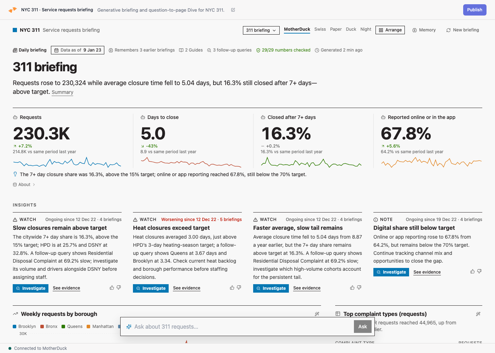
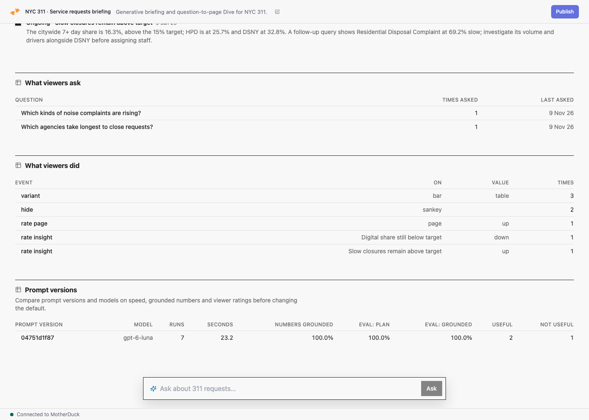

# Build a Self-Learning Briefing Dive

A Dive whose pages are generated, not hand-built, and that gets better the more it is used. Every morning a Flight writes a briefing. It covers the numbers that matter, the insights that need attention with how each changed since last week, and the charts that show the evidence. Viewers can ask a new question and get a new page, or click **Investigate** on an insight to get a drill-down that explains it.

The example uses NYC 311 service requests from MotherDuck's public `sample_data` share. Five weekly briefings in, it flags heat-complaint closures as *worsening since 12 December*. A follow-up query it chose found Queens at 3.67 days against the 3-day target in its Guide, and the headline shows "29/29 numbers checked".



## How it works

```
Dive ──useRunFlight({ MODE, PROMPT, PARENT, FEEDBACK, … })──► Flight
  marts     curated tables from your sources
  plan      prompt() picks catalog measures, dimensions and components (strict JSON schema)
  compile   Python validates the plan and writes the SQL; the model never does
  probe     prompt() proposes follow-up queries that test why something moved
  narrate   prompt() writes the headline and insights, using memory, Guides and the
            follow-up results; every number is checked against the data
  publish   one JSON spec row the Dive renders, plus log rows
  learn     a memory Guide: what the briefing has learned
Dive ◄── useFlightRun ── opens the new page
```

Four things make it learn:

- **Memory.** Every run, model call, insight and viewer signal is logged in the output database. The next briefing reads back the last three briefings' insights and marks each new one as new, ongoing, worsening, improving or resolved. Viewer ratings and the chart types people switch to steer the next analysis and the default layout.
- **Guides.** The Flight reads every MotherDuck Guide under `briefings/<db>`. That includes your business context (audience, targets, known patterns) and the memory Guide it maintains itself. Edit a Guide and the next briefing follows it. The Dive's AI Chat and other agents read the same Guides.
- **Questions.** When the data shows what moved but not why, such as a spike in one week or one referrer, the briefing asks its viewers, with a few likely answers to pick from. An answer becomes a note. The note appears on every chart that shows that date or value, and later briefings use it as the explanation. Questions nobody has answered stay on the page. Viewers can also pin a note to any chart.
- **Evals.** `eval.py` scores the planner, and with `--narrate` the share of grounded numbers, on a fixed question set. Results are recorded per prompt version and model, so you can compare a prompt or model change before it ships. The Dive's **Memory** page shows the insight timeline, what viewers asked and did, and every prompt version.



## Questions to answer

Ask these before adapting the recipe; the answers go into a Guide (see `business-context.sql`), the recipe and `questions.json`:

1. Who reads the briefing, how often, and what do they decide after reading it?
2. Which 3 to 5 numbers matter most, how exactly are they defined, and which are better when lower?
3. What are the targets, and what size of change is worth reporting?
4. Compare with what: the previous period, last year, or the target?
5. Which breakdowns explain a change, and which should the briefing ignore?
6. Which known patterns, events or data quirks matter?
7. Who acts on which kind of insight, and what does a useful one look like?
8. Which questions do you expect to ask it?

After the first briefing, ask which insight they would act on, which is noise, and what is missing, and update the Guide.

## What you'll adjust

Copy `recipes/nyc-311` to `recipes/<name>` and replace:

- **`domain.py`:**
  - `DB` (a new output database) and `ATTACH` (your sources).
  - `MARTS`: curated tables, pre-aggregated where you can.
  - `CATALOG`: datasets, dimensions and measures, with descriptions the planner reads. Mark measures where lower is better with `"down"`, and include the dimensions that explain why a number moves.
  - `WATCH`: metrics for the change scan.
  - `BRIEFING_PLAN`: the fixed daily page.
  - Context for the model, and the learning settings: `GUIDE_TOPICS`, `ANALYST_PROBES`, `DEFAULT_MODEL`.
- **`app.json`:** brand, theme (`motherduck`, `swiss`, `paper`, `duck`, `night`, or a brand spec such as `{ "base": "paper", "accent": "#0f766e" }`), example questions and the Flight name.
- **`questions.json`:** 8 to 12 questions with what a good plan uses, plus one off-topic question.
- **`business-context.sql`:** your interview answers as a Guide.

The components live in `dive-components/`: KPI rows, metric cards, gauges, line, area, bar, table, calendar and matrix heatmaps, Sankey, treemap, timeline, callouts and a date picker. Add your own by copying `dive-components/examples/funnel.tsx`.

## Run it

```bash
export MOTHERDUCK_TOKEN=...
python3 build.py recipes/nyc-311                      # writes recipes/nyc-311/flight/main.py and dive/index.tsx
cd recipes/nyc-311/flight
MODE=briefing REQUEST_ID=t1 uv run --with duckdb==1.5.6 python main.py
MODE=ask PROMPT="Which agencies take longest to close requests?" REQUEST_ID=t2 uv run --with duckdb==1.5.6 python main.py
cd ../../..
uv run --with duckdb==1.5.6 python eval.py recipes/nyc-311 --out baseline.json
```

Run the business-context Guide once (`business-context.sql`), and run several briefings with consecutive `AS_OF=YYYY-MM-DD` dates to see insights continue across weeks.

Deploy the Flight and the Dive:

```bash
uv run --with duckdb==1.5.6 python deploy.py recipes/nyc-311 --dry-run   # shows what it will create or update
uv run --with duckdb==1.5.6 python deploy.py recipes/nyc-311
```

`deploy.py` creates or updates the Flight with `MD_CREATE_FLIGHT` or `MD_UPDATE_FLIGHT`, finding it by name in `MD_LIST_FLIGHTS()`. It writes the Flight id into `app.json`, rebuilds, and creates the Dive or adds a version with `MD_CREATE_DIVE` or `MD_UPDATE_DIVE_CONTENT`. Then run the briefing once (`SELECT * FROM MD_RUN_FLIGHT(flight_id := '<id>')`) and open the Dive.

To let others use it:
- **Read access:** they need a share of the output database. Set `requiredDatabases` in `app.json` to the share.
- **Asking questions and rating:** they need run access on the Flight: `GRANT RUN ON FLIGHT '<flight_id>' TO ROLE <role>`. Every run uses the Flight owner's credentials, so grant it to the people the Dive is for.

## Caveats

- **Run time:** each generation makes two or three `prompt()` calls (plan, follow-up queries, narrative) and takes about 15 to 35 seconds. Set `ANALYST_PROBES = 0` to drop the follow-up step.
- **Writes:** a Dive can't write to a database. Viewer feedback reaches the log tables only through a Flight run, which validates every event.
- **Model:** `DEFAULT_MODEL` names the `prompt()` model. Check current model names in the AI functions docs.
- **Agent skills:** the recipe matches the `motherduck-build-malleable-dive` and `motherduck-dive-components` agent skills. With them installed, an agent can run the interview and adapt the recipe for you.

## Files

| Path | What it is |
| --- | --- |
| `template/engine.py` | The Flight engine: plan, compile, probe, narrate, publish, learn |
| `template/app.tsx` | The Dive: pages, ask bar, Investigate, Arrange mode, ratings, Memory page |
| `dive-components/` | The component kit and its catalog (`components.json`), copied into the Dive |
| `recipes/nyc-311/` | The example recipe, eval questions included |
| `build.py` | Builds a recipe into a single-file Flight and Dive |
| `eval.py` | Scores a recipe's planner and narrator |
| `deploy.py` | Creates or updates the Flight and the Dive |
| `business-context.sql` | The interview answers as a Guide |
| `LEARNING.md` | The log tables, memory, feedback, the number check and evals in detail |

## Learn more

- [Guides](https://motherduck.com/docs/key-tasks/guides/) and the [Guide SQL functions](https://motherduck.com/docs/sql-reference/motherduck-sql-reference/guides/)
- [Run Flights from Dives](https://motherduck.com/docs/key-tasks/dives/run-flights-from-dives/)
- [`prompt()`](https://motherduck.com/docs/sql-reference/motherduck-sql-reference/ai-functions/prompt/)
- [NYC 311 sample data](https://motherduck.com/docs/getting-started/sample-data-queries/nyc-311-data/)
