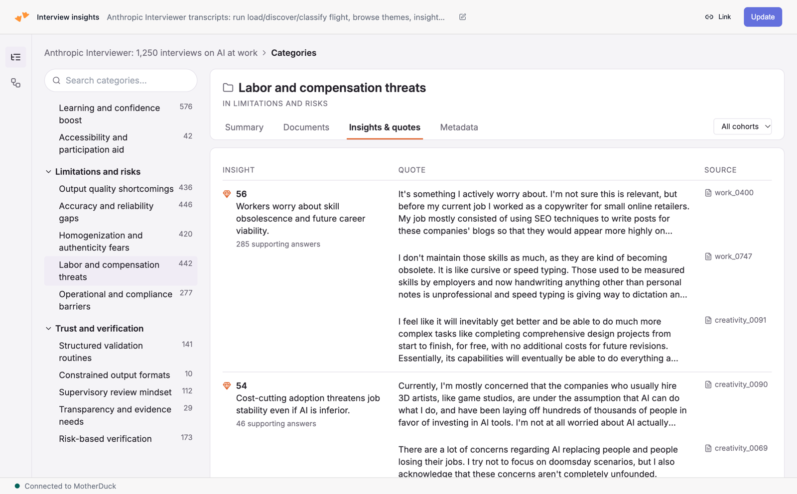

# Find themes and quotes in interview transcripts with AI SQL

Qualitative research on a few hundred interviews usually means a week in a
spreadsheet: read a sample, write a codebook, then tag every answer by hand.
This recipe does that work in SQL. A Flight loads the transcripts, `prompt()`
drafts a codebook from a sample, a researcher edits it in a Dive, and
`prompt_jev()` classifies every participant answer against it, with sentiment
and a quotability score.

It ships with the public
[Anthropic Interviewer](https://huggingface.co/datasets/Anthropic/AnthropicInterviewer)
dataset: 1,250 interviews about AI at work, in three cohorts (workforce,
creatives, scientists), 14,495 participant answers. Swap `load_turns()` for
your own source and everything after it works unchanged.



Three files:

- `flight/flight.py` runs one phase per run, chosen by `PHASE`.
- `dive/src/dive.tsx` triggers the phases, edits the codebook, and browses the results.
- `deploy.py` creates or updates both and wires the Dive to the Flight.

## How it works

The Flight has one entrypoint and six phases. The Dive starts a run with
`PHASE` and any per-run values as config overrides, waits for it, then
refetches.

| Phase | What it does | AI function | Time on the sample data |
|---|---|---|---|
| `load` | Reads the source into `turns` (one row per speaker turn) and `transcripts`, then runs `describe` | `prompt()` | ~10 s |
| `describe` | Writes a 2 to 4 sentence corpus summary and suggests context fields (source, domain, period, participants, research question) | `prompt()` | ~5 s |
| `discover` | Takes `SAMPLE_PER_COHORT` transcripts per cohort, extracts 3 to 6 observations with a verbatim quote each, then consolidates them into groups, themes and insights | `prompt()` with a JSON schema | ~40 s |
| `edit` | Applies a batch of codebook edits (add, update, delete, merge) in one transaction | none | ~4 s |
| `classify` | Assigns every participant answer to a theme (or `other`) with sentiment, matches it to an insight within that theme, scores quotability, then summarizes each theme | `prompt_jev()`, `prompt()` | ~16 s for 11,791 answers |
| `reset` | Empties every pipeline table | none | ~4 s |

On the sample data, one `discover` run with `gpt-6-luna` produced 5 groups, 23
themes and 69 insights from 335 observations, and 99.4% of the extracted quotes
were verbatim. A full `classify` put 6.9% of answers in `other`. After a few
rounds of codebook edits, that dropped to 3 to 4% on 500-answer tests.

### Why two AI functions

`prompt()` is a general LLM call: good for open-ended work like writing a
codebook, slow and costly per row. `prompt_jev()` is a fast classifier that
takes a fixed list of labels (`choice :=`) or a 5-point scale (`score :=`)
and returns the label with its probabilities. That makes it cheap enough to run
on every answer, and the probabilities feed the Dive: the runner-up theme shows
which themes the classifier confuses, which is the evidence for a merge.

`prompt_jev()` needs constant instructions, so the Flight renders the codebook
into SQL literals at run time. That is also why the sentiment question is a
config value and not a query parameter.

### Tables it writes

All in `<DATABASE>.main`.

| Table | One row per |
|---|---|
| `turns` | speaker turn: cohort, transcript, order, speaker, text, the previous turn's text |
| `transcripts` | conversation, rendered with `Participant:` / `Interviewer:` labels |
| `corpus` | the corpus summary and researcher-confirmed context (one row) |
| `sample`, `observations` | sampled transcript; extracted insight with its quote and a `verbatim` flag |
| `groups`, `themes`, `insights` | the codebook. `theme_id` is `group_id * 100 + n` |
| `turn_themes` | classified answer: theme (`NULL` = other), confidence, sentiment from -1 to 1, runner-up theme |
| `turn_insights` | answer above the `CONF` threshold: matched insight (`NULL` = none), confidence, quotability |
| `theme_summaries` | theme: a 3-sentence summary from its most quotable answers |
| `pipeline_runs` | finished run: phase, time, and a JSON blob of counts |

### The Dive

Three views. **Overview** shows the corpus summary and context, KPIs, and the
four steps (load, discover, review, classify) with run buttons and recent runs.
**Codebook** is the review step: rename, redefine, re-rank, merge or delete
themes as a local draft, submit it as one `edit` run, test it on 500 answers,
then classify everything. It also asks `prompt()` for suggested edits based on
low-confidence themes and close calls. **Categories** is the browser: a theme
tree with a summary, the matched insights with their best quotes, and the
source documents per theme.

## Questions to answer

- Where do the transcripts live, and what is the speaker convention? `load_turns()` needs one row per turn with `cohort`, `transcript_id`, `turn_no`, `speaker` and `text`.
- Who are the participants and who is the interviewer? Only `speaker = 'participant'` turns are coded. In a sales call, that is the customer.
- What should `cohort` be? It drives the stratified sample and the filters: team, segment, survey wave, region.
- What is the research question? Put it in the Dive's corpus context. It is prepended to every prompt.
- What should sentiment measure? The default asks how the participant feels about AI in their work. Rewrite `SENTIMENT_QUESTION` for your subject.
- Which database should hold the results (`--database`), and who else should see them?

## Caveats

- **`prompt()` needs OpenAI's `response_format` wrapper around a JSON schema.**
  Pass `{"name": ..., "strict": true, "schema": {...}}`. A bare schema returns
  `NULL` for every row, with no error. `schema_arg()` in the Flight builds the
  wrapper; reuse it if you add prompts.
- **Insight matching is by exact label text.** `prompt_jev()` returns the
  label, and the Flight joins it back to `themes` and `insights` by name. Theme
  names must be unique, and `other` is reserved. The `edit` phase rejects
  both.
- **A new codebook clears the classifications.** `discover` deletes
  `turn_themes`, `turn_insights` and `theme_summaries`, because their ids no
  longer mean anything. `edit` does not, but the Dive shows the coding as stale
  until the next `classify`.
- **Long `prompt()` calls can return `NULL`.** The codebook call sends every
  observation to one large model. It retries three times, then fails the run.
  Lower `SAMPLE_PER_COHORT` if it keeps failing.
- **Costs scale with answers, not transcripts.** `classify` runs two
  `prompt_jev()` calls per answer, plus two more per answer above `CONF`. Use
  `LIMIT_TURNS=500` (the Dive's "Test on 500" button) before a full run.
- **Viewers need run access to the Flight.** A Dive viewer who presses Run uses
  their own identity. Grant them run access on the Flight, or the Dive shows a
  permission message. Restricted members can't run Flights.
- **Sharing the Dive means sharing the data.** To show it to others, share the
  Dive's data (the `share_dive_data` MCP tool, or a share of `<DATABASE>`). The
  Flight runs `CREATE SNAPSHOT` at the end of every run, and the Dive runs
  `REFRESH DATABASE` after every successful run, so viewers on a share see new
  results without waiting for the share to sync.
- **Open the Dive after the first `load`.** `deploy.py` creates the database,
  but the tables only exist once the Flight has run.

## What you'll adjust

| Knob | Where | Default | Purpose |
|---|---|---|---|
| `load_turns()` | `flight/flight.py` | Anthropic Interviewer CSVs from Hugging Face | Your source. Return a `SELECT` with `cohort`, `transcript_id`, `turn_no`, `speaker` (`participant` or `interviewer`), `text`. |
| `SOURCE_NAME`, `SOURCE_URL` | `flight/flight.py` | Anthropic Interviewer | Shown in the Dive. |
| `OBS_PROMPT`, `CB_PROMPT` | `flight/flight.py` | 3 to 6 observations; 4 to 6 groups x 3 to 5 themes x 2 to 4 insights | Shape and size of the codebook. |
| `DATABASE` | Flight config, `--database` | `interview_insights` | Where every table lives. `deploy.py` points the Dive at the same database. |
| `MODEL` | Flight config, Dive dropdown | `gpt-6-luna` | Model for `describe` and `discover`. Also `gpt-5`, `gpt-5-mini`, `gpt-4.1`, `gpt-4o` and their smaller variants. |
| `SUMMARY_MODEL` | Flight config | `gpt-5-mini` | Model for the per-theme summaries. |
| `SAMPLE_PER_COHORT` | Flight config, Dive | `20` | Transcripts per cohort that `discover` reads. |
| `MIN_CHARS` | Flight config | `80` | Shorter answers ("Yes", "Sure") are not classified. |
| `CONF` | Flight config | `0.4` | Minimum theme confidence before matching an insight and scoring quotability. |
| `LIMIT_TURNS` | Flight config, Dive | `0` (all) | Classify a deterministic subset, for tests. |
| `SENTIMENT_QUESTION` | Flight config | How the participant feels about AI in their work | The question the sentiment score answers. |
| `CONTEXT`, `SUMMARY`, `EDITS` | Sent by the Dive per run | empty | Corpus context, a researcher-written summary, and codebook edits. |
| `C`, `MODELS` | `dive/src/dive.tsx` | | Colors, and the models offered in the Dive's dropdowns. |

### Codebook edits

`EDITS` is a JSON list of up to 100 edits. Themes added in the same batch take
a negative temporary id that later edits can reference:

```json
[
  {"op": "add", "id": -1, "group": 4, "name": "Pricing confusion", "description": "Use when ...", "importance": 2},
  {"op": "update", "id": 101, "name": "Early ideation", "description": "Use when ...", "importance": 3},
  {"op": "merge", "id": 102, "target": -1},
  {"op": "delete", "id": 305}
]
```

A theme's description is what the classifier reads, so phrase it as a rule:
"Use when the participant ..., excluding ...".

## Run it

Deploy the Flight and the Dive, then run `load`:

```bash
export MOTHERDUCK_TOKEN=your_token_here   # read-write
uv run --with-requirements flight/requirements.txt deploy.py --run load
```

The script resolves the Flight by name through `MD_LIST_FLIGHTS()` and the Dive
by title through `MD_LIST_DIVES()`. It creates each the first time and updates
it after, so no id is pinned in the repo. It writes the Flight id and the
database name into the Dive source on upload. It prints the Dive URL; open it
and continue from the Overview: Discover, review the codebook, Classify.

Deploy into another database, or change a default:

```bash
uv run --with-requirements flight/requirements.txt deploy.py \
  --database customer_calls \
  --config SENTIMENT_QUESTION="How does the customer feel about the product, based on this answer?"
```

Run a phase without the Dive:

```bash
uv run --with-requirements flight/requirements.txt deploy.py --run discover
```

To run the Flight locally instead, set the config as environment variables:

```bash
cd flight
PHASE=load uv run --with-requirements requirements.txt flight.py
PHASE=discover uv run --with-requirements requirements.txt flight.py
PHASE=classify LIMIT_TURNS=500 uv run --with-requirements requirements.txt flight.py
```

Then read the result:

```sql
-- Themes by size and sentiment
SELECT t.theme_name, count(*) AS answers, round(avg(tt.sentiment), 2) AS sentiment
FROM interview_insights.main.turn_themes tt
JOIN interview_insights.main.themes t USING (theme_id)
GROUP BY ALL ORDER BY answers DESC;

-- The five most quotable answers per insight
SELECT i.insight, tu.text, ti.quotability
FROM interview_insights.main.turn_insights ti
JOIN interview_insights.main.insights i USING (insight_id)
JOIN interview_insights.main.turns tu USING (turn_id)
QUALIFY row_number() OVER (PARTITION BY ti.insight_id ORDER BY ti.quotability DESC) <= 5;

-- How each run went
SELECT phase, finished_at, details FROM interview_insights.main.pipeline_runs ORDER BY finished_at DESC;
```

### Deploy as a Flight

`deploy.py` calls `MD_CREATE_FLIGHT` / `MD_UPDATE_FLIGHT` with `name`,
`source_code` (`flight/flight.py`), `requirements_txt`
(`flight/requirements.txt`), `instance_type := 'F16'`,
`max_runtime_sec := 3600`, and a `config` map with every knob above. To do
it by hand, pass the same arguments. A MotherDuck token is attached to the
Flight automatically and injected at run time as `MOTHERDUCK_TOKEN`. The Flight
needs no secrets: the AI functions run in MotherDuck, and the sample data is
public.

Run a phase with `MD_RUN_FLIGHT(flight_id := ..., config := MAP {'PHASE': 'discover'})`.
Per-run keys override the stored config for that run only. That is how the
Dive sends `PHASE`, `EDITS` and `LIMIT_TURNS`.

## Security

- **The researcher's text goes into SQL as literals.** `prompt_jev()` needs
  constant instructions, so theme names, descriptions and insights are
  embedded with `q()`, which doubles single quotes. Keep that helper on any
  new literal.
- **Every config value is validated.** `DATABASE` must match
  `^[A-Za-z_][A-Za-z0-9_]*$`, numbers have ranges, models come from an
  allow-list, and `EDITS` and `CONTEXT` are parsed and length-checked before
  any SQL runs. Edits apply in one transaction and roll back on the first bad
  one.
- **Transcripts are sent to a model.** `prompt()` and `prompt_jev()` run
  through MotherDuck's AI functions. Check that your interview consent and
  data-processing terms allow it before loading real participants.
- **The Dive can write.** Anyone with run access on the Flight can rewrite or
  `reset` the codebook and the tables. Grant run access to researchers, not to
  every viewer.

## Learn more

- [AI functions in MotherDuck](https://motherduck.com/docs/sql-reference/motherduck-sql-reference/ai-functions/): `prompt()` and `prompt_jev()`.
- [Anthropic Interviewer dataset](https://huggingface.co/datasets/Anthropic/AnthropicInterviewer).
- Flight mechanics, run instrumentation (`@flight` / `@flight-run` log lines) and Dive authoring: use the MotherDuck MCP `get_flight_guide`, `get_flight_viz_guide` and `get_dive_guide` tools.
- Deeper MotherDuck or DuckDB questions: use the `ask_docs_question` MCP tool.
