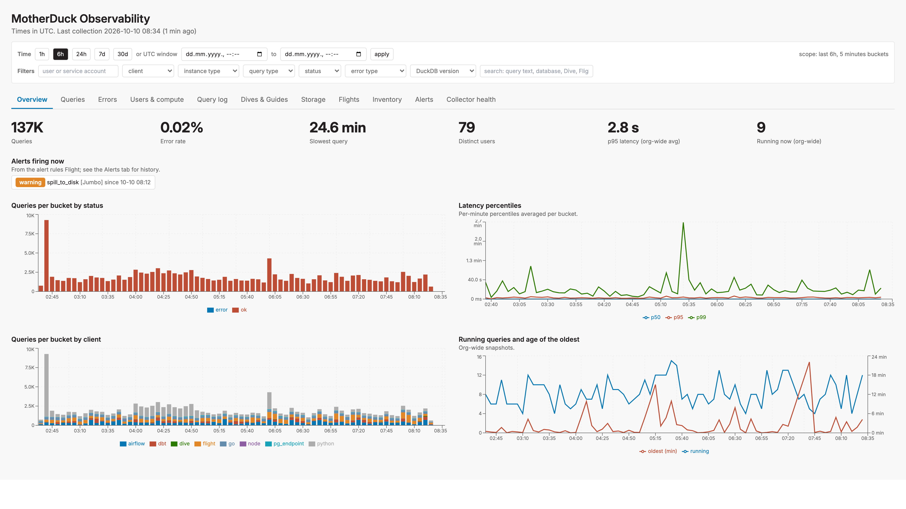

# Monitor MotherDuck From MotherDuck

Two scheduled Flights and a Dive that monitor a MotherDuck organization from
inside MotherDuck. The collector Flight reads MotherDuck's own metadata views
(`md_information_schema.query_history`, `recent_queries`, `storage_info`,
`md_access_tokens()`, `MD_LIST_FLIGHTS()`, ...) every five minutes and
aggregates them into typed tables; the alert rules Flight evaluates nine rules
over those tables and posts to Slack; the Dive shows the same nine dashboard
groups as the [Monitor MotherDuck in Datadog](https://motherduck.com/docs/cookbook/motherduck-datadog)
recipe, read through an organization share.

It demonstrates three MotherDuck patterns: **a Flight as a metrics collector**
that aggregates server-side with `INSERT ... SELECT` (no rows leave
MotherDuck), **a Flight as an alerting rule engine** with its own state and
ledger tables, and **a Dive over an organization share** as the dashboard.
Both Flights, the database, its share and the Dive are owned by one service
account, so nothing depends on a person's credentials; the only external
credential is a Slack webhook stored as a Flights secret.

It needs a **Business or Enterprise plan**: `md_information_schema.query_history`
and `recent_queries`, which almost every collector reads, are Business-plan
views, and scheduled (cron) Flights are not available on Lite without a card
on file. The service account that runs it needs the **Builder** preset role
at least (query history) or **Admin** (adds storage metrics and org-wide
Flight counts); see [Security](#security).



## How it works


Each run of [`flight.py`](flight.py):

1. **Picks a window.** The window ends three minutes ago (`DELAY_SECONDS`,
   because `query_history` lags live traffic by one to two minutes) and starts
   where the previous run stopped. That watermark lives in the one-row `state`
   table, so late or skipped runs never double-count or drop a minute. The
   first run starts `BACKFILL_HOURS` back (default 24 h); a gap after a paused
   schedule is caught up `MAX_CATCHUP_HOURS` per run.
2. **Aggregates completed queries per minute** from `query_history`, bucketed
   by `end_time`: counts, spill and transfer bytes and max/avg latency by query
   type, instance type and status (`query_minutes`); p50/p95/p99 latency and
   queue wait (`query_latency_minutes`); errors by `error_type`
   (`query_error_minutes`); the same measures at the full user, client, DuckDB
   version, query type, instance type, status and error type grain
   (`query_detail_minutes`, what the Dive's filters run on; `client` is UI,
   Dive, Flight, MCP, dbt, ... read from `user_agent`); and, because every
   query a Dive runs carries `md-dives/v1(<dive_id>)` in `user_agent`, queries,
   viewers and errors per Dive for the busiest `TOP_DIVES` Dives
   (`dive_minutes`). The `SLOW_QUERIES` slowest queries of the window land in
   `slow_queries` with a truncated text.
3. **Snapshots point-in-time gauges** into `captured_at`-keyed tables: running
   queries and the age of the oldest one (`recent_queries`), org storage totals
   and the `STORAGE_TOP_DATABASES` largest databases (`storage_info`, admin
   only), databases, access tokens and tokens expiring within 7 days, Flights
   (and the runs that finished in the window for the Flights in
   `FLIGHT_RUN_SCOPE`), Dives by status with owners and 7-day create/update
   counts, Guides by access and topic, roles, and active users over the window,
   24 h, 7 d and 30 d.
4. **Records its own health** in `exporter_runs` (one row per run) and
   `collector_runs` (one row per collector per run, with the error if it
   failed), deletes rows older than `RETENTION_DAYS`, and advances the
   watermark.

Every write is idempotent for its window: the rows of the window are deleted
before they are inserted again, so a re-run never double-counts. Every
collector is isolated: if one fails (for example `storage_info` when the token
is not an org admin) the run logs a warning, records `ok = false` in
`collector_runs`, and still writes the rest. The `exporter_runs` table is the
signal that the collector itself is alive.

### Tables

All in `TARGET_DATABASE.TARGET_SCHEMA` (default `md_observability.main`),
created on the first run.

| Table | Key | Rows per run | Contents |
| --- | --- | --- | --- |
| `query_minutes` | `minute`, `query_type`, `instance_type`, `status` | minutes × combinations | queries, spilled queries and bytes, bytes up/down, max/avg latency, max queue wait |
| `query_latency_minutes` | `minute` | minutes | p50/p95/p99 latency and p95 wait of successful queries |
| `query_error_minutes` | `minute`, `error_type` | | failed queries by DuckDB error class |
| `query_detail_minutes` | `minute`, `user_name`, `client`, `duckdb_version`, `query_type`, `instance_type`, `status`, `error_type` | minutes × combinations | the measures of `query_minutes` at the full grain; `client` is `ui`, `dive`, `flight`, `mcp`, `dbt`, `dlt`, `airflow`, `pg_endpoint`, `node`, `python`, `go`, `jdbc` or `other` |
| `dive_minutes` | `minute`, `dive_id` | ≤ `TOP_DIVES` × minutes | queries, distinct viewers, errors, slowest query per Dive |
| `slow_queries` | `window_end` | `SLOW_QUERIES` | slowest queries of the window with user, client, version, instance, wait, spill, error type and truncated text |
| `activity_snapshots` | `captured_at` | 1 | users and ducklings active in the window, active users 24 h / 7 d / 30 d, Dives queried and viewers |
| `duckling_snapshots` | `captured_at`, `instance_type` | | distinct ducklings that served queries in the window |
| `running_queries` | `captured_at` | 1 | queries running right now, distinct users, age of the oldest |
| `running_queries_by_type` | `captured_at`, `query_type`, `instance_type` | | running queries broken down |
| `storage_totals` | `captured_at` | 1 | org-wide bytes by kind, databases with storage, owners (admin only) |
| `storage_snapshots` | `captured_at`, `database_name` | ≤ `STORAGE_TOP_DATABASES` | bytes by kind of the largest databases (admin only) |
| `inventory_counts` | `captured_at`, `entity`, `dimension`, `label` | | databases by type, tokens by type and expiring, Flights by status and schedule status, Dives by status, Guides by access and topic, roles by type |
| `catalog_snapshots` | `captured_at`, `entity` | 2 | Dives and Guides: total, distinct owners, created and updated in 7 days |
| `flight_runs` | `run_id` | runs ended in window | Flight name, status, scheduled flag, start, end, duration |
| `flight_run_snapshots` | `captured_at`, `flight_id` | tracked Flights | pending or running runs per Flight |
| `exporter_runs` | `run_at` | 1 | window, duration, collectors ok/failed, rows written |
| `collector_runs` | `run_at`, `collector` | 5 | success, duration, rows and error per collector |
| `state` | `exporter` | | the watermark |
| `alert_state` | `check_name`, `group_key` | | current status, value, episode start, last notification (written by `alerts.py`) |
| `alert_events` | `evaluated_at` | transitions | old and new status, kind, value, thresholds, whether Slack was posted (written by `alerts.py`) |

### Alert rules

- [`alerts.py`](alerts.py) is a second Flight, scheduled two minutes after
  each collection. Each rule in its `CHECKS` list is one SQL query over the
  tables that returns `(group_key, value)` rows, plus warning and critical
  thresholds and a runbook line. The nine shipped rules are the nine monitors
  of the Datadog recipe: error rate above 2 % / 5 % over 15 minutes, average
  p95 latency above 10 s / 30 s, a query running longer than 15 / 30 minutes,
  more than 25 / 100 GB spilled in 30 minutes per instance type, a failed
  Flight run in the last 30 minutes, an access token expiring within 7 days,
  active storage growing more than 10 % / 25 % in a day, the collector not
  reporting for 15 minutes, and a collector failing on every run for 15
  minutes.
- Each `(rule, group)` has a row in `alert_state`. A transition into
  `warning`/`critical` posts to Slack (one message per run, listing every
  transition), a transition back to `ok` posts a recovery when
  `NOTIFY_ON_RESOLVE` is on, and an alert that keeps firing is re-posted after
  its `renotify_minutes`. A group that stops appearing in a rule's result (a
  Flight with no failed run in the last 30 minutes) is resolved. Every event
  is appended to `alert_events`, which the Dive's Alerts tab reads. Slack is
  posted before the state is written, so a failed webhook fails the run and
  the alert is retried next time instead of being lost.
- A message is actionable on its own. Each rule links to the Dive view that
  explains it, and the query-level rules attach up to `DETAIL_ROWS` example
  queries from the live metadata views (query id, duckling id, user, the
  offending value, the query text), each linked to that query in the Dive's
  Query log. A recovery says the value now and how long the episode lasted
  and carries the same examples, so a long-running query that finished
  between two runs is still named. The headline counts what the message
  contains and what is still firing; "all clear" means no rule is firing.

### Dashboard

- [`dive/dive.tsx`](dive/dive.tsx) has eleven tabs: Overview, Queries,
  Errors, Users & compute, Query log, Dives & Guides, Storage, Flights,
  Inventory, Alerts and Collector health. A filter bar applies to every tab: a
  time scope (presets from 1 h to 30 d, or a custom UTC window) and filters on
  user, client, instance type, query type, status, error type, DuckDB client
  version, a text search (query text, Dive titles, Flight names, database and
  owner names) and a query id. Panels that cannot be filtered (org-wide
  percentiles, running queries, snapshots) say so.
- The **Query log** tab is the diagnostic view: it reads MotherDuck's live
  `query_history` with the same filters, so it shows exact percentiles for the
  filtered set, error messages grouped by type, and the 50 most recent,
  slowest, most spilled or longest-queued queries with their text. It runs as
  the person viewing the Dive, so it needs the "view query history" permission
  (Admin and Builder preset roles); Explorers see a note instead. Every other
  tab reads the share and works for anyone the share is granted to.
- Tab, scope and filters travel with the Dive's URL (`#state=<base64url
  JSON>`, one key per `useDiveState` call), which is what the Slack links use.
- [`deploy_dive.py`](deploy_dive.py) creates a share of the metrics database,
  grants it to the organization and creates or updates the Dive over it, so
  anyone can open the Dive even though the service account owns the data.

## Questions to answer

- Which service account owns the deployment, and which RBAC preset role does
  it hold? **Builder** is the minimum: `query_history` and `recent_queries`
  need the "view query history" permission, which Explorer lacks. **Admin**
  additionally unlocks `storage_info`; without it the Storage tab stays empty
  and the `storage_info` collector reports as failed.
- Where should the tables live (`TARGET_DATABASE`), and who may read them? The
  deploy script grants the share to the `explorer` role (everyone); pass
  `--grant <role>` to narrow it. The Dive's Query log tab is the exception: it
  reads live `query_history` as the viewer, so only Builders and Admins see it.
- How much history should the first run backfill (`BACKFILL_HOURS`) and how
  long should rows be kept (`RETENTION_DAYS`)? Per-minute tables for a busy org
  grow by roughly 5,000 rows an hour, most of them in `query_detail_minutes`.
- Which Slack channel receives alerts, and is its Incoming Webhook stored as a
  Flights secret named `slack`?
- Should warnings page the channel (`ALERT_LEVEL=warning`) or only criticals?
  Should recoveries be posted (`NOTIFY_ON_RESOLVE`)?
- Which Flights should have their runs tracked: only the service account's
  (`FLIGHT_RUN_SCOPE=own`), every scheduled Flight in the org (`scheduled`,
  needs an admin), or all? Each tracked Flight costs one call of about half a
  second per run.
- Do the thresholds in `CHECKS` match the organization? A quiet org's p95 is
  the slowest query; a large org spills 25 GB routinely.

## Caveats

- **`query_history` and `recent_queries` need Builder; `storage_info` needs
  Admin.** An Explorer-only service account gets `User not authorized` from
  every query collector, so the deployment is useless; a Builder gets it only
  from `storage_info`, where the collector is skipped, not fatal, and the
  `collector_failing` rule says so. A newly granted role took a few minutes to
  apply to Flight runs in testing. `md_access_tokens()` and
  `MD_LIST_FLIGHTS()` only see the service account's own tokens and Flights
  unless it is an admin, so `token_expiring` watches the collector's tokens,
  not everyone's.
- **Per-minute percentiles are noisy on quiet orgs.** With a handful of
  queries per minute, p95 and p99 are effectively the slowest query. The Dive
  averages them per bucket and the `p95_latency` rule averages 15 minutes;
  raise its thresholds or window if it is noisy.
- **"Users" means active users.** MotherDuck has no SQL view or REST endpoint
  that lists an organization's members, so `users_24h/7d/30d` count distinct
  `user_name`s in `query_history`. A user who never queries is invisible;
  service accounts count like people.
- **Timezones.** The Flight runtime has no timezone configured, so both
  Flights pin `SET TimeZone = 'UTC'` before reading any `TIMESTAMPTZ` column;
  without it the duckdb client raises `'Etc/Unknown'`. Keep that line if you
  add queries. The Dive labels everything in UTC.
- **`recent_queries` is a live view and dislikes some predicates.** A
  `WHERE end_time IS NULL` filter, `ORDER BY start_time` or an unbounded scan
  can fail with an internal MotherDuck error. The collector only runs plain
  aggregates against it and retries each read; keep to that shape.
- **`limit` and `order` are reserved words.** Named arguments to
  `MD_LIST_FLIGHT_RUNS` and `MD_GET_FLIGHT_LOGS` must be double-quoted:
  `"limit" := 20`.
- **Runs must not overlap.** The watermark is read at the start of a run and
  written at the end. A run that finds a previous run of the same Flight still
  `RUNNING` skips itself; cap runs below the schedule interval
  (`--max-runtime 240` with a 5-minute cron).
- **An admin token sees the whole organization.** `MD_LIST_FLIGHTS()` then
  covers every Flight in the org (hundreds in a busy org, about 0.5 s each for
  run metrics), which is why the default scope is `own` and the collector has
  a time budget (`FLIGHT_RUNS_BUDGET_SEC`).
- **The alert value can be up to five minutes old.** Rules read the collector's
  last snapshot, so the example queries attached to a message are fetched live
  and include queries that finished in the meantime.
- **Dive titles are recorded at collection time.** `dive_minutes.dive_title`
  is the title when the row was written; group by `dive_id` across renames.
- **The share exposes the whole database, query text included.** The
  `slow_queries` table holds truncated query text, and `query_detail_minutes`
  holds user names. Grant the share to a narrower role, set `SLOW_QUERIES=0`,
  or `DETAIL_MINUTES=false` (the Dive's filters then have nothing to run on)
  if that is more than the organization should see. The Query log tab reads
  the viewer's own `query_history`, which MotherDuck already exposes org-wide.
- **One org per deployment.** Both Flights report on the organization of the
  token they run with. Deploy once per organization if you have several.
- **Thresholds are static.** Rules compare against fixed numbers, not against
  a learned baseline; adjust `CHECKS` after a week of data.

## What you'll adjust

Everything is an environment variable. Locally you `export` it; on a Flight it
is a `config` key, except the webhook, which is a Flights secret, and the
alert rules, which are the `CHECKS` list at the top of `alerts.py`.

| Knob | Default | Purpose |
| --- | --- | --- |
| `TARGET_DATABASE` / `TARGET_SCHEMA` | `md_observability` / `main` | Where every table lives; created on first run. Both Flights read it |
| `WINDOW_MINUTES` | `5` | Window size when there is no state and no backfill. Match the cron |
| `DELAY_SECONDS` | `180` | How far behind "now" the window ends, to let `query_history` settle |
| `BACKFILL_HOURS` | `24` | History the first run aggregates; `0` starts with one window |
| `MAX_CATCHUP_HOURS` | `24` | Largest window one run covers after a gap |
| `RETENTION_DAYS` | `90` | Rows older than this are deleted at the end of each run; `0` keeps all |
| `DETAIL_MINUTES` | `true` | Write `query_detail_minutes` (every user; what the Dive filters on); `false` disables |
| `TOP_DIVES` | `20` | Busiest Dives per window that get `dive_minutes` rows; `0` disables |
| `STORAGE_TOP_DATABASES` | `25` | Largest databases that get `storage_snapshots` rows; totals are always written |
| `SLOW_QUERIES` | `5` | Slowest queries per window kept in `slow_queries`; `0` disables |
| `FLIGHT_RUN_SCOPE` | `own` | Which Flights get run metrics: `own`, `scheduled`, `all`, `none` |
| `FLIGHT_RUNS_BUDGET_SEC` | `60` | Time budget for the Flight-runs collector (about 0.5 s per Flight) |
| `CHECKS` | nine rules | The alert rules: name, title, SQL returning `(group_key, value)`, `op`, `warning`, `critical`, `unit`, `renotify_minutes`, `runbook`, optional `details` SQL and the `dive` view to link |
| `SLACK_WEBHOOK_URL` | (secret) | Slack Incoming Webhook. Flights secret param; the code also accepts the namespaced `slack_SLACK_WEBHOOK_URL` |
| `ALERT_LEVEL` | `warning` | Lowest status that posts to Slack: `warning` or `critical` |
| `NOTIFY_ON_RESOLVE` | `true` | Post a recovery message when an alert returns to ok |
| `DETAIL_ROWS` | `3` | Example queries attached to a query-level alert and its recovery; `0` disables |
| `DIVE_URL` | (none) | The observability Dive; appended to every Slack message and the base of the deep links |
| `ALERT_SOURCE` | `MotherDuck` | Label in the Slack headline, e.g. the org or environment |
| `DRY_RUN` | `false` | Collector: run everything in a transaction and roll it back. Rules: evaluate and print, no Slack, no state |
| `MOTHERDUCK_TOKEN` | (Flight-injected) | Attached automatically to a Flight; `.env` holds the service account's token for local runs |
| Schedules | `*/5 * * * *` and `2-59/5 * * * *` | Set with `--schedule` on `deploy_flight.py` or `MD_UPDATE_FLIGHT`; the rules run two minutes after the collector |
| Instance size | `F4` | `--instance-type` on `deploy_flight.py` (`instance_type` in `MD_CREATE_FLIGHT`). The smallest runner is enough: the aggregation runs inside MotherDuck and the Flights only move small result sets |
| Share audience | `explorer` | `--grant <role>` on `deploy_dive.py`, repeatable |
| Dive status | `draft` | `--status ready` (or `endorsed`, admins only) on `deploy_dive.py` |

## Run it

Prerequisites: a MotherDuck organization on a Business or Enterprise plan
where you can create a service account and assign it a role (the Admin preset
role), and a Slack workspace where you can create an Incoming Webhook.
[`uv`](https://docs.astral.sh/uv/) runs the scripts with pinned dependencies.

### 1. Create the service account

Everything is owned by one service account, so the deployment survives people
leaving and credential rotations. As an organization admin,
[`setup_service_account.py`](setup_service_account.py) creates it, mints a
read/write token, grants it a role and writes the token to a local `.env`
that the deploy scripts read:

```bash
export MOTHERDUCK_ADMIN_TOKEN=<your admin read/write token>   # or log in with the MotherDuck CLI
uv run --with-requirements requirements.txt setup_service_account.py
```

By default the account is `md_observability_svc` with the **Admin** role,
which storage metrics and org-wide Flight counts need; pass `--role builder`
for a narrower account that skips those. Builder is the minimum: a new
service account is an Explorer, and Explorers cannot read `query_history` or
`recent_queries`, so the script refuses to skip the grant unless you pass
`--role none` and arrange the role yourself. The same steps in the UI:
**Settings > Service accounts > Create service account**, then **Create
token** (Read/Write), then grant the role; see
[Service accounts](https://motherduck.com/docs/key-tasks/service-accounts-guide/).
Every command below runs as that token:

```bash
set -a; source .env; set +a      # exports MOTHERDUCK_TOKEN
```

### 2. Smoke-test locally

```bash
DRY_RUN=true uv run --with-requirements requirements.txt flight.py
```

This creates the database and tables, aggregates the first window (24 hours
with the default `BACKFILL_HOURS`), prints each collector's outcome and row
count, then rolls everything back. Drop `DRY_RUN` to write for real; the
tables fill in a few seconds and
`SELECT * FROM md_observability.main.exporter_runs` shows the run.

### 3. Deploy the collector as a Flight

[`deploy_flight.py`](deploy_flight.py) resolves a Flight by name through
`MD_LIST_FLIGHTS()`, so the same command creates it the first time and updates
it after you edit the source:

```bash
uv run --with-requirements requirements.txt deploy_flight.py \
  --source flight.py --name md-observability-collector \
  --schedule "*/5 * * * *" --max-runtime 240 \
  --config FLIGHT_RUN_SCOPE=scheduled --run
```

`--run` triggers one run, polls it to completion and prints its log, so the
first deploy doubles as the end-to-end test. Both Flights deploy on the
smallest runner (`F4`, half a vCPU and 4 GB) because the work happens inside
MotherDuck; pass `--instance-type F16` if a run ever fails from memory
pressure. Without the script, call the SQL surface directly: `MD_CREATE_FLIGHT`
with `source_code` = `flight.py`, `requirements_txt` = `requirements.txt`,
`config := MAP {...}`, `schedule_cron := '*/5 * * * *'` and
`instance_type := 'F4'`; trigger with `MD_RUN_FLIGHT` and read the log with
`MD_GET_FLIGHT_LOGS`.

### 4. Deploy the dashboard

```bash
uv run --with-requirements requirements.txt deploy_dive.py --status ready
```

The script creates a restricted share of the metrics database, grants READ to
the `explorer` role (everyone in the organization; pass `--grant <role>`
for a narrower audience), substitutes the share URL into `dive/dive.tsx`,
creates the Dive (or updates it in place when a Dive with the same title
exists) and prints its URL. Open it: the Overview tab shows the backfilled
history right away.

### 5. Deploy the alert rules as a Flight

Create one Incoming Webhook for the channel that should receive alerts (see
the [Slack docs](https://docs.slack.dev/messaging/sending-messages-using-incoming-webhooks/):
**api.slack.com/apps > Create New App > Incoming Webhooks > Add New Webhook to
Workspace**). Store it as a MotherDuck **Flights secret** of the service
account (a Flight only sees its owner's secrets), named `slack` with one param,
`SLACK_WEBHOOK_URL`. Add the URL to the local `.env` next to the token
(`SLACK_WEBHOOK_URL=https://hooks.slack.com/services/...`) and let the deploy
below create the secret from it with `--secret-from-env`; the value never
appears on the command line or in logs. Or from a write-enabled SQL connection
as the service account:

```sql
CREATE SECRET slack IN motherduck (
  TYPE flights,
  PARAMS MAP { 'SLACK_WEBHOOK_URL': 'https://hooks.slack.com/services/...' }
);
```

Smoke-test the rules first (no Slack, no state written), then deploy two
minutes behind the collector so it always evaluates fresh rows:

```bash
DRY_RUN=true uv run --with-requirements requirements.txt alerts.py

uv run --with-requirements requirements.txt deploy_flight.py \
  --source alerts.py --name md-observability-alerts \
  --secret-from-env slack=SLACK_WEBHOOK_URL \
  --schedule "2-59/5 * * * *" --max-runtime 120 \
  --config DIVE_URL=https://app.motherduck.com/dives/<dive id> --run
```

`--secret-from-env` creates (or replaces) the secret and attaches it; on later
deploys `--secret slack` attaches the existing one. The first run posts
nothing unless a rule is already beyond its threshold; to prove the webhook
works, lower a threshold in `CHECKS` (for example set `p95_latency`'s
`warning` to `1000`) for one local run, and the next scheduled run posts the
recovery.

### Verify

- `SELECT * FROM md_observability.main.exporter_runs ORDER BY run_at DESC LIMIT 5`
  shows a row every five minutes with `collectors_failed = 0` (or `1` with
  `storage_info` failing for a non-admin token).
- `SELECT * FROM md_observability.main.alert_state` lists every rule with its
  current status; the Dive's Collector health and Alerts tabs show the same.
- The Flight run logs list each collector with its duration and row count, and
  each rule with its value and decision.

## Security

- **One identity, scoped by role.** Deploy with the service account's token
  and it owns the database, the share, both Flights and the Dive. It needs the
  **Builder** preset role for `query_history` and `recent_queries` (the "view
  query history" permission, which Explorer does not have) and **Admin** only
  if you also want storage metrics and org-wide Flight counts.
- **Secrets never touch code or config.** The webhook is read from the
  environment (`SLACK_WEBHOOK_URL` or the namespaced `slack_SLACK_WEBHOOK_URL`
  injected by the Flights secret). The MotherDuck token is injected by the
  runtime. Neither is logged.
- **Identifier validation.** `TARGET_DATABASE` and `TARGET_SCHEMA` are checked
  against `^[A-Za-z_][A-Za-z0-9_]*$` before they are interpolated into DDL and
  DML; so are the share, database and role names in `deploy_dive.py`. Every
  other SQL value (window bounds, limits, Flight ids, Dive content) is a bound
  parameter. Rule SQL in `CHECKS` is code you own, not user input.
- **What the share exposes.** Everything the collector writes, which includes
  user names, Dive titles, Flight names, database names and truncated query
  text of the slowest queries. Grant the share to a narrower role than
  `explorer` if that is more than the organization should see, or disable the
  `slow_queries` and `query_detail_minutes` tables with `SLOW_QUERIES=0` and
  `DETAIL_MINUTES=false`.
- **What leaves MotherDuck.** Only the Slack messages: rule names, group keys
  (a Flight name, an instance type, a collector name, a token type), values,
  the runbook text and, for query-level rules, the example queries with their
  user, duckling id and truncated text. Set `DETAIL_ROWS=0` to keep query text
  and user names out of Slack.
- **Read mostly.** The collector reads metadata views and writes only to
  `TARGET_DATABASE`. The alert rules read that database and the live metadata
  views, and write only the two `alert_*` tables.

## Learn more

- [`flight.py`](flight.py): the collector. Collectors are small functions
  near the bottom; add a table by adding it to `TABLES` and writing an
  `INSERT ... SELECT` in the collector that fills it.
- [`alerts.py`](alerts.py): the rules engine. Add a rule by appending to
  `CHECKS`; `tests/test_alerts.py` runs every rule against the schema.
- [`dive/dive.tsx`](dive/dive.tsx): the dashboard. Every chart is a bucketed,
  gap-filled time series built by `seriesSql` or `keyedSql`; add a panel with
  one of them and a `Lines`, `Stacked` or `Table` component.
- [`setup_service_account.py`](setup_service_account.py): the service account,
  its token and role through the Admin REST API and `GRANT ROLE`.
- [`deploy_flight.py`](deploy_flight.py) and [`deploy_dive.py`](deploy_dive.py):
  register, update and run through `MD_CREATE_FLIGHT` / `MD_UPDATE_FLIGHT` /
  `MD_RUN_FLIGHT` and `MD_CREATE_DIVE` / `MD_UPDATE_DIVE_CONTENT`.
- [`tests/`](tests/): unit tests for both Flights, from the collector's DDL
  and window arithmetic to every alert rule and the notification state machine
  (`uv run --with pytest --with-requirements requirements.txt -m pytest`).
- [`assets/`](assets/): the Dive screenshot and the architecture diagram
  (`architecture.svg` is the editable source).
- The sibling recipe [Monitor MotherDuck in Datadog](https://motherduck.com/docs/cookbook/motherduck-datadog)
  collects the same metrics for Datadog; [Alert on Stale Tables From a Flight](https://motherduck.com/docs/cookbook/flight-freshness-alert)
  is the single-rule version of the alerting pattern.
- MotherDuck metadata views: [`query_history`](https://motherduck.com/docs/sql-reference/motherduck-sql-reference/md_information_schema/query_history/),
  [`recent_queries`](https://motherduck.com/docs/sql-reference/motherduck-sql-reference/md_information_schema/recent_queries/),
  [`storage_info`](https://motherduck.com/docs/sql-reference/motherduck-sql-reference/md_information_schema/storage_info/);
  [service accounts](https://motherduck.com/docs/key-tasks/service-accounts-guide/);
  [shares and roles](https://motherduck.com/docs/sql-reference/motherduck-sql-reference/create-share/).
- For Flight mechanics (secrets, schedules, versions, logs) use the MotherDuck
  MCP `get_flight_guide` tool; for Dive authoring, `get_dive_guide`; for the
  metadata views, `ask_docs_question`.
