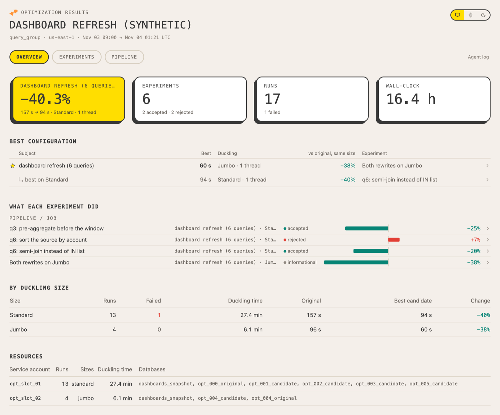
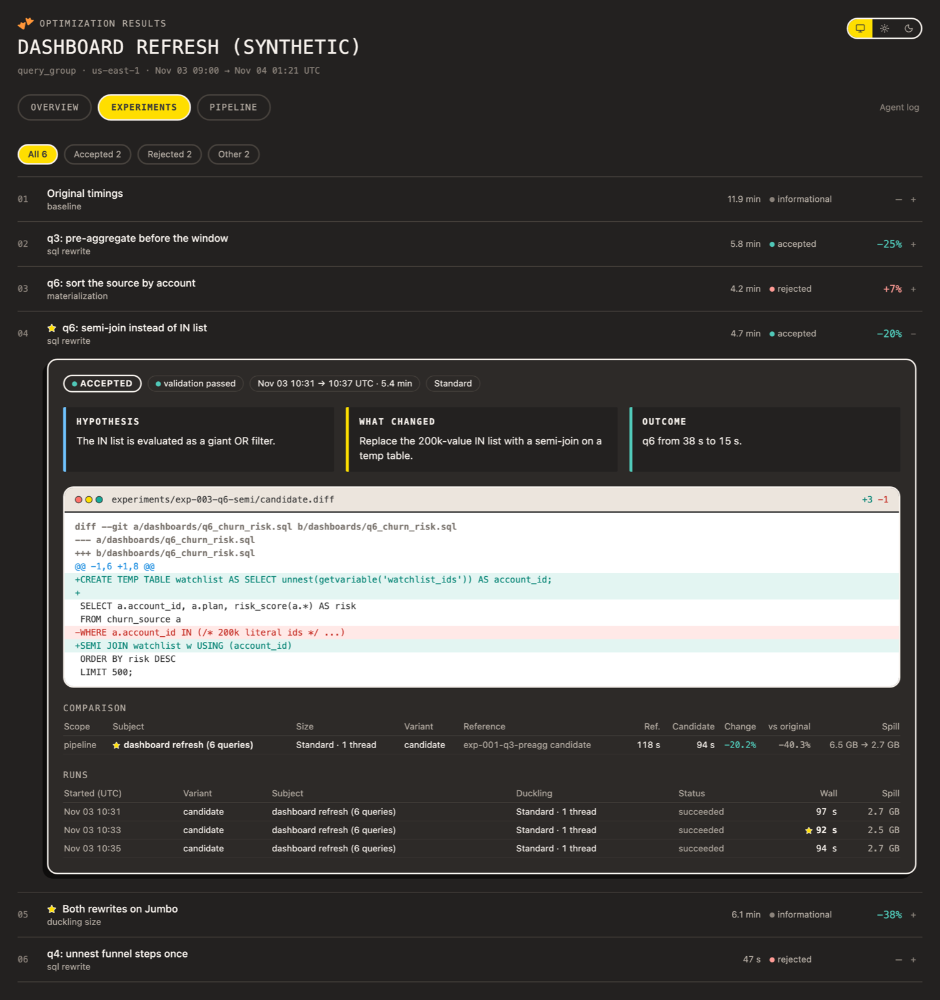
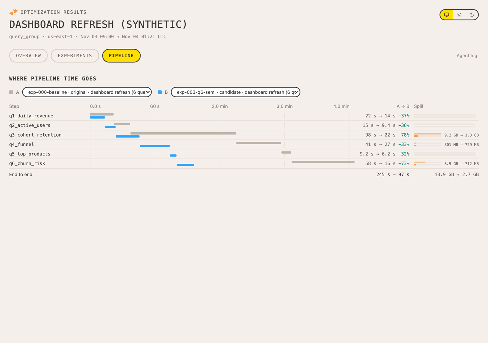

# Optimization results database and Dive

Every campaign writes what it did to a MotherDuck results database, so the user can follow the
loop while it runs and review it afterwards in the **Optimization results** Dive: what each
experiment changed, what it gained or cost, which Duckling sizes were used, where pipeline time
goes, and what the agent spent its time on.

```
agent ──► optimization/results.jsonl ──► record_results.py ──► optimization_results ──► optimization_results_share ──► Dive
           (append-only ledger)            (log / load)          (tables + views)        (UPDATE AUTOMATIC)
```

The ledger is the source of truth. The database can always be rebuilt from it with `load`, and
a failed upload never loses a result.

| Overview | Experiment | Pipeline |
| --- | --- | --- |
|  |  |  |

Screenshots use a synthetic campaign. The Dive follows the MotherDuck light or dark theme and has
a manual toggle.

## Set up once per organization

Use an observer token (read/write on the results database; never the experiment token):

```bash
export MOTHERDUCK_TOKEN=...   # observer token
# newest DuckDB that MotherDuck supports; a newer client may not connect
export DUCKDB_VERSION=$(curl -fsS https://api.motherduck.com/latest_supported_duckdb_version.txt)
uv run --with "duckdb==$DUCKDB_VERSION" python results/record_results.py setup
```

Always install DuckDB at the version that endpoint returns. Don't hardcode a version, and don't
install the latest from PyPI.

`setup` is idempotent. It creates the `optimization_results` database, its tables and views
([schema.sql](schema.sql)), the `optimization_results_share` share (organization access,
automatic updates), and the Dive from [dive/optimization_results_dive.tsx](dive/optimization_results_dive.tsx).
The Dive id is remembered in `results/.dive_id`; rerunning `setup` updates the same Dive.

| Option | Default | Meaning |
| --- | --- | --- |
| `--database` | `optimization_results` | Results database (all commands). |
| `--share-access` | `organization` | `unrestricted` lets anyone with the link read results. |
| `--no-share` | off | Keep results private; the Dive then reads the database directly. |
| `--dive-id` | `.dive_id` | Update an existing Dive instead of creating one. |
| `--token-env` | `MOTHERDUCK_TOKEN` | Environment variable holding the observer token. |

Creating a share grants access to its data: confirm the access level with the user first. When
`MD_CREATE_DIVE` is unavailable, an agent with the MotherDuck MCP server can save the Dive source
with `save_dive` after pointing `REQUIRED_DATABASES` at the share.

## Logging rules for agents

Log as you go, not at the end. Each `log` call appends to `optimization/results.jsonl` and
reloads the campaign (a few seconds), so the Dive stays current. Log what the campaign actually
did; never run extra work only to fill a Dive section.

**Core (always):**

1. **Campaign, before provisioning:** goal, workload kind, source snapshot, region, headline
   subject/size/threads (what the campaign is judged on), `status: running`.
2. **Experiment, before its first run:** title, hypothesis, `change_kind`, `change_summary`,
   `status: running`, `decision: pending`. If it builds on an earlier candidate rather than the
   original workload, set `baseline_experiment_id` (and `baseline_variant`, default `candidate`).
3. **Every run, right after it ends:** stable `run_id`, `variant`, `subject`, `scope`
   (`query` / `model` / `pipeline`), `duckling_size`, `threads`, `purpose`, `status`,
   timestamps and `wall_s`. Log failures, OOMs, timeouts and invalid runs too, with the reason
   in `error` or `notes`; never drop a run.
4. **Decision, when the experiment ends:** re-log the experiment with `status`, `decision`,
   `reason` and `validation_status` (rules below). Partial records merge field by field.
5. **Campaign end:** re-log the campaign with `status: complete` (or `abandoned`).

**Optional (log when the campaign has it; each lights up a Dive section):**

| Data | How | Dive |
| --- | --- | --- |
| Pipeline steps | `--dbt-run-results target/run_results.json`, or a `steps` list | Pipeline tab |
| Step spill | step `query_ids` (or `spill_bytes`); filled from `query_history` with an admin token | Spill column on the Pipeline tab |
| Candidate diff | `diff_path` on the experiment (save it before the first run) | Change panel per experiment |
| Slots and databases | run `service_account`, `databases`, `command` | Resources on Overview, run details |
| Server time, wait, spill | run `query_ids` with an admin token, or the fields directly | Run columns in each experiment |
| Agent activity | `event` records (`plan`, `profile`, `validate`, `analyze`, `wait`, ...) | Agent log (secondary tab) |

### Variants and comparisons

| `variant` | Meaning |
| --- | --- |
| `original` | The unmodified workload. The campaign-wide reference for its subject, size and threads. |
| `baseline` | This experiment's own reference, when it is not the original (e.g. the current best). |
| `candidate` (or any other label) | What the experiment tries. |

Only `purpose: measure` runs that `succeeded` are timings; warm-ups and profiles
(`EXPLAIN ANALYZE`) are shown but never compared. The views compare medians of candidate runs
with the reference of the **same subject, Duckling size and threads**:

- `delta_pct` — against the experiment's reference: its own `baseline` runs, else the referenced
  experiment's variant, else the original. This is what the change did.
- `vs_original_pct` — against the original. This is the cumulative gain.
- `effect` — `improved` / `regressed` when `delta_pct` is beyond the campaign's `noise_pct`
  (default 5), otherwise `neutral`; `no_baseline` when nothing comparable was measured.

So a size or thread experiment must also measure (or reference) the reference at that size and
thread count, or it shows `no_baseline`.

`v_leaderboard` ranks, per subject, the candidates that are safe to adopt (accepted, or
validated informational runs such as size and thread sweeps) and not slower than their
reference: `rank = 1` is the fastest on any Duckling size, `size_rank = 1` the fastest per
size. The Dive marks these with a star and lists them under "Best configuration".

### Decisions

`effect` is computed; `decision` is the agent's recommendation. `load` warns when they disagree.

| Decision | Use when | Warning when |
| --- | --- | --- |
| `accepted` | Validation passed and the change improves the headline subject (or its target) beyond noise at the agreed size/threads. | validation is not `passed`, or no comparison is `improved` |
| `rejected` | Validation failed; slower or within noise; failed, OOM or timed out. | no `reason` |
| `inconclusive` | Gain within noise but promising, too few samples, validation inconclusive, or sizes disagree. | no `reason` |
| `informational` | Nothing to adopt: original timings, size/thread sweeps, profiling only. | a candidate `improved` (should it be accepted?), except size and thread sweeps |
| `pending` | Not decided yet. | the experiment is `complete` |

## Adapt the Dive to the campaign

The Dive is a template. Sections without data hide themselves (Pipeline without steps,
Resources without slots, Change without a diff, Agent log without events), so a campaign that
logged only the core still gets a complete page. At the end of a campaign, review it with the
user and adapt [the source](dive/optimization_results_dive.tsx) when the defaults don't fit:

- Rename subjects or the headline so they read in the user's terms (e.g. "nightly dbt build").
- Remove sections the user doesn't need, or reorder them (for example, Pipeline first for dbt).
- Keep text short: titles and numbers, no explanatory paragraphs.

Publish changes with `setup --dive-id <id>` (same Dive) or save a copy for one campaign.

## Record reference

Timestamps are ISO-8601 (UTC or with an offset). `campaign_id` defaults to the one in
`optimization/campaign.json`.

| Type (key) | Fields |
| --- | --- |
| `campaign` (`campaign_id`) | `title`, `goal`, `workload_kind` (`query` / `query_group` / `dbt`), `workload_ref`, `source_snapshot`, `region`, `headline_subject`, `headline_size`, `headline_threads`, `noise_pct`, `status`, `agent`, `envelope` (object), `created_at` |
| `experiment` (`experiment_id`) | `title`, `hypothesis`, `change_kind` (`baseline` / `sql_rewrite` / `materialization` / `incremental` / `config` / `duckling_size` / `threads` / `other`), `change_summary`, `targets` (list), `status`, `decision`, `reason`, `validation_status` (`passed` / `failed` / `inconclusive` / `not_run`), `diff_path` (relative to the ledger; its text is uploaded as `diff_text`), `baseline_experiment_id`, `baseline_variant`, `created_at` |
| `run` (`run_id`) | `experiment_id`, `variant`, `label`, `subject`, `scope` (`query` / `model` / `pipeline`), `duckling_size`, `threads`, `repetition`, `purpose` (`measure` / `warmup` / `profile`), `status` (`succeeded` / `failed` / `oom` / `timeout` / `cancelled` / `invalid`), `triggered_at`, `started_at`, `finished_at`, `wall_s`, `server_s`, `wait_s`, `spill_bytes`, `rows_out`, `query_ids` (list), `service_account` (slot user name, never a token), `databases` (list), `command` (secrets redacted), `error`, `notes`, `steps` (list of `name`, `kind`, `status`, `started_at`, `finished_at`, `duration_s`, `rows_out`, `spill_bytes`) |
| `event` (`event_id`, generated if omitted) | `kind`, `summary`, `experiment_id`, `run_id`, `started_at` (defaults to now), `finished_at` |

## Examples

```bash
R="uv run --with duckdb==$DUCKDB_VERSION python results/record_results.py"   # DUCKDB_VERSION from setup

$R log --type campaign --json '{"campaign_id": "orders-dbt-2026-11", "title": "Orders dbt project",
  "goal": "Cut the nightly dbt build without changing results", "workload_kind": "dbt",
  "region": "us-east-1", "headline_subject": "dbt build (selected models)", "headline_size": "jumbo",
  "headline_threads": 4, "status": "running", "agent": "Claude Code"}'

$R log --type experiment --json '{"experiment_id": "exp-002-orders-rowid-join",
  "title": "orders_enriched: integer row-id join", "change_kind": "sql_rewrite",
  "hypothesis": "The string-keyed re-join re-sorts 80M rows", "change_summary": "Carry rowid and join on it",
  "targets": ["orders_enriched"], "status": "running", "decision": "pending"}'

# a dbt job: steps, wall time and status come from run_results.json
$R log --type run --dbt-run-results target/run_results.json --json '{"run_id": "exp-002/jumbo-t4-cand-01",
  "experiment_id": "exp-002-orders-rowid-join", "variant": "candidate", "subject": "dbt build (selected models)",
  "scope": "pipeline", "duckling_size": "jumbo", "threads": 4, "triggered_at": "2026-11-05T09:12:03Z"}'

# a scripts/benchmark.py pair: one run per warm-up and measured run; query_history fills server time and spill.
# --baseline-is-original records the pair's baseline as the unmodified workload (omit it when the
# baseline is an earlier candidate).
$R log --type run --baseline-is-original --benchmark optimization/experiments/exp-003/pair/benchmark.json --json '{"experiment_id": "exp-003",
  "subject": "daily_revenue", "scope": "query", "duckling_size": "standard"}'

$R log --type event --json '{"kind": "validate", "experiment_id": "exp-002-orders-rowid-join",
  "summary": "Bidirectional EXCEPT ALL: identical", "started_at": "2026-11-05T09:40:00Z", "finished_at": "2026-11-05T09:46:10Z"}'

$R log --type experiment --json '{"experiment_id": "exp-002-orders-rowid-join", "status": "complete",
  "decision": "accepted", "validation_status": "passed", "reason": "orders_enriched 412 s -> 198 s; outputs identical"}'

# rebuild the campaign from the ledger at any time
$R load --ledger optimization
```

`query_history` enrichment needs an organization admin token; without one, `server_s`,
`wait_s` and `spill_bytes` stay empty unless the record provides them.
